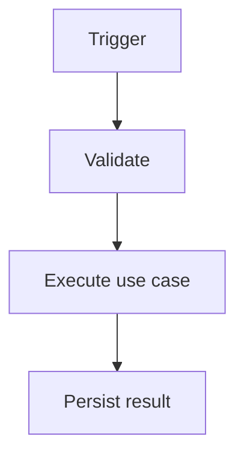

# Technical Plan — [FEATURE_NAME]

## Current-state findings

[Relevant code, modules, contracts, constraints, and existing behavior.]

## Proposed design

[Describe the solution and why it is the smallest appropriate design.]

## Components and ownership

| Component | Responsibility | Change |
|---|---|---|
| [COMPONENT] | [RESPONSIBILITY] | Add/Modify/Reuse |

## Data and API contracts

[Schema, migrations, endpoints, events, messages, compatibility.]

## Flow

Replace this example with the real flow or remove it.

## Security, privacy, and trust boundaries

[Identity, authorization, untrusted inputs, secrets, data retention, external systems.]

## Failure modes and recovery

| Failure | Expected behavior | Retry/compensation |
|---|---|---|
| [FAILURE] | [BEHAVIOR] | [STRATEGY] |

## Testing strategy

- Unit:
- Integration/contract:
- E2E:
- Security/abuse:
- Performance/reliability:

## Alternatives and trade-offs

[Options considered and why selected approach is preferable.]

## Rollout and migration

[Feature flag, migration order, backfill, rollback/forward-fix, monitoring.]

## Implementation slices

1. [VERTICAL SLICE + ACCEPTANCE]
2. [VERTICAL SLICE + ACCEPTANCE]

## Open questions

- [QUESTION]
